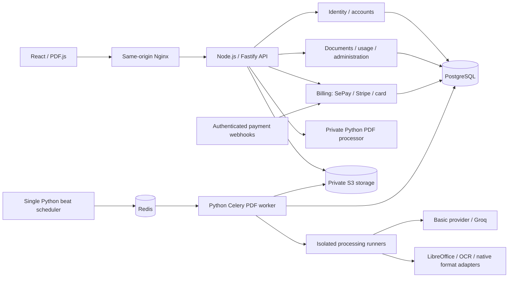

# Transler architecture

## Decision: modular monolith with separate workers

Transler uses one Node.js/TypeScript API divided into business modules and separate Python processing services. React is served through same-origin Nginx. PostgreSQL owns accounts, plans, payments, documents, jobs and usage; Redis transports Celery work and stores rate limits; private S3-compatible storage owns file bytes. Business modules share transactions rather than calling one another over the network. Python workers scale independently from the API.

Small functions implement application behavior over runtime-validated contracts. Connectors own PostgreSQL, Redis, storage and external HTTP boundaries. There are no independent authentication or billing microservices: one API keeps authorization, quotas and payment activation transactional.

## Responsibilities and invariants

- `api/src/contracts.ts` validates HTTP and database results with Zod. Public responses exclude passwords, owner internals, run tokens and checkpoint keys. Python `contracts.py` validates processor and worker data.
- `api/src/server.ts` owns Fastify lifecycle, same-origin enforcement, transport limits and OpenAPI. `modules/identity.ts` handles guest and authenticated ownership, with HTTP routes in `identity-routes.ts`; `documents.ts` and `jobs.ts` handle PDF/job requests through `document-service.ts`; `usage.ts` owns quota queries and reports; `admin.ts` owns administrator operations; `billing.ts` owns payment HTTP routes, `checkout.ts` creates orders, and `payment-settlement.ts` verifies settlement and activates plans.
- `backend/src/transler/processor.py` exposes authenticated internal PDF analysis and HTTPS import. It is not the public business API. `services.py` provides owned worker queries.
- Each workspace row serializes document quota and job idempotency decisions. Node commits job dispatch records to PostgreSQL; Python beat delivers them to Celery. Node never publishes an incompatible Celery payload.
- `pdf.py` validates input and output without changing source bytes. Untrusted upload parsing runs in a subprocess with a wall deadline, CPU limit, monitored resident memory, and a Linux address-space cap. Translation runs in a separate non-root container with memory/CPU limits and a read-only filesystem.
- `import_url.py` validates every redirect, rejects non-public DNS answers, and connects to a vetted IP while retaining the original TLS hostname. It never uses environment proxies or automatically follows redirects.
- `engine.py` is the PDFMathTranslate process boundary. One subprocess owns a job, with a wall deadline, cancellation, and lease fencing. Atomic per-page files are acknowledged only after checkpoint publication, providing backpressure without buffering the entire job. Vendor dependencies stay optional for API/beat images.
- `pdf_layout.py` owns the pinned converter/interpreter integration. The layout model and target font are loaded once per job. ONNX inference uses two intra-op threads for the worker's two-CPU budget and one inter-op thread, with idle spinning disabled so network waits do not saturate container CPU. Each page is translated from the immutable source and inserted into the cumulative checkpoint, retaining PDF images and vector content. Source links and the outline are restored after page replacement. Each translated single page subsets its used font glyphs before insertion, preventing full target fonts from being duplicated across pages. Checkpoint validation inspects the newly completed page; the final quality report inspects all pages once.
- `bing.py` owns a job-scoped HTTP session, validated translation responses, bounded retries, sentence-aware segmentation, and protected formula placeholders. No source tail is truncated to the vendor adapter's 1,000-character limit. A dedicated exception escapes the vendor converter's otherwise unbounded retry once provider attempts are exhausted.
- `worker.py` coordinates claims and checkpoints. Its module docstring describes the durable dispatch and fencing protocol.
- `storage.py` keeps source, checkpoint, and result keys separate. Downloads require an owning session or hashed API credential; explicit share links grant bounded read-only downloads. Bucket objects remain private.
- Alembic is the single migration authority for the shared PostgreSQL contract. Migrations add accounts, plans, authenticated sessions, usage ledger, payment orders/events and audit events. No second ORM manages the same tables.

Every document has an immutable original artifact. Successful processing produces a separate artifact with its own filename/MIME type. PDF translations include a heuristic quality report. A checkpoint contains the cumulative PDF after a completed page; changing target language creates a new job. Each job snapshots the provider, LLM model and input units so recovery keeps the same engine/model and quota basis after a deployment change.

The job row doubles as a durable dispatch record: committing `QUEUED` does not depend on successful broker delivery. The dispatcher delivers runnable rows; a transactional claim grants a run token and short lease. Heartbeats extend that lease. Every worker write checks its run token, and final artifact publication checks status under a row lock. Duplicate delivery and stale workers cannot overwrite an active execution.

Provider/process failures receive at most three automatic attempts with visible diagnostics and a retry delay. Manual retry starts a new attempt cycle using the persisted page checkpoint. Operation idempotency keys must match the original document, input artifact and typed options. Basic keys match the document and language pair. Cancellation is cooperative during subprocess execution; worker recovery finalizes abandoned cancellations.

## Operation and retention

Compose starts PostgreSQL, Redis, and SeaweedFS, runs migrations/bucket provisioning, then starts Node API, private PDF processor, PDF worker, maintenance worker, beat, and web. The maintenance queue has its own consumer so long PDF tasks cannot starve dispatch and retention. SeaweedFS implements the S3 interface for local single-node deployment; production can configure another S3-compatible endpoint through the same connector. Infrastructure replacement does not affect document logic.

Guest sessions expire seven days after creation, without sliding extension. Expired session data is inaccessible immediately; an hourly maintenance job deletes its database rows and object prefix. Registered workspaces are excluded from guest cleanup. Registration retains the guest workspace and rotates its guest token; sign-in opens the account workspace. The bucket has no global object expiry because registered documents persist; abandoned multipart uploads are pruned. Explicit document deletion refuses active jobs and removes original, result, and checkpoint data. Expiry revokes execution tokens before cleanup, so workers cannot publish results for deleted sessions.

Provider failures are stored on the job and logged with structured job/attempt fields. API liveness and dependency readiness are separate endpoints. Operations use container/application logs and persisted job diagnostics. Account administration, reports, plans and payment review are implemented.

Bing uses the explicit complete-segment connector; the other configured services retain vendor adapters. Public endpoint availability and Basic translation semantics remain provider-dependent. Output checks are deliberately labeled heuristic. They cannot prove semantic completeness, glossary compliance, within-block overflow, or preservation of every PDF object. Advanced validates protected tokens and glossary targets; semantic quality still requires assessment against real documents.

## Processing features

### Selected PDF engine architecture

The selected replacement architecture has two layout engines and one translation gateway. This is the target design; the deployed translation runners still use PDFMathTranslate, and the current OCR operation adds a searchable layer rather than replacing scanned text. Installing the new engines alone does not implement this pipeline.

| Component | Responsibility |
| --- | --- |
| Preflight / orchestrator | Validate input, classify pages, select engine work, persist checkpoints and assemble results. |
| BabelDOC adapter | Translate pages with a usable text layer and reconstruct their native PDF layout. |
| Scan Engine | Recognize text with PaddleOCR, remove source glyphs with OpenCV, and compose translated text over the restored scan. Scope: white backgrounds, ordinary text and simple tables. |
| Translation Gateway | Select the configured Basic service or specialist LLM; enforce timeouts, bounded retries, caching, glossary and protected-token validation. It does not reconstruct layout. |
| QA / assembly | Validate engine outputs, restore document metadata and page navigation, and publish a separate processed artifact. |

Both engines use the same translation policy. Basic uses an explicitly configured translation service, such as DeepL; specialist translation uses the configured LLM with document context and glossary. Credentials must exist for the selected service. Engine failures never trigger an implicit provider or layout-engine substitution.

Preflight distinguishes native, scanned, hybrid, blank and review-required pages. Extractable text alone does not prove that a page is native: a scan can contain an invisible OCR layer, or only a native header over a scanned body. Unsupported hybrid regions and complex scan backgrounds require an explicit review diagnostic. Blank pages retain their original position without OCR or translation.

The BabelDOC adapter declares capabilities against a pinned version: whole-document input, supported page selections, output page mapping and context behavior. Prefer passing the complete immutable PDF with a native-page selection when that version supports it. Do not assume independent single-page execution or force the native engine into Scan Engine's IR. If extraction is necessary, the adapter owns the explicit source-page map and documents the context boundary. The assembly stage checks that each original page appears exactly once, in order, with matching boxes and rotation; it restores metadata, bookmarks, links and page labels. Forms, annotations and signatures require explicit preservation validation or an unsupported-input error, rather than a blanket preservation promise.

Transler's versioned IR contains document provenance and only the regions controlled by Scan Engine. Geometry uses top-left-origin, unrotated PDF points; render transforms explicitly map OCR pixels into that coordinate system. Page records retain media/crop boxes and rotation. Region records contain source and translated text, bounding box, polygon, optional baseline, rotation, reading order, OCR confidence, region type, paragraph/cell relationships, estimated style/font/color with provenance, and private source-mask references. Unknown font/style data remains explicitly unknown. Native results normalize engine/version, page mapping and diagnostics without importing BabelDOC's complete internal IR.

Scan processing renders at a bounded resolution, keeps table rules separate from glyph masks, and removes only recognized source text. Translation units are paragraphs or table cells rather than individual OCR lines. Composition checks text fit instead of clipping overflow or shrinking text without a readability limit. Low OCR confidence, unsupported background, restoration damage or failed text fit produces a review-required diagnostic; it does not publish a success with missing text.

Celery Canvas coordinates coarse stages: preflight, native document/range processing, scan OCR/layout batches, translation batches, restoration/composition, QA and assembly. Each engine retains ownership of its layout decisions. Redis transports work and Canvas results; PostgreSQL remains authoritative for job status, leases and checkpoint metadata; private object storage holds the original, IR, masks, intermediates and final PDF. Task messages carry identifiers and artifact references rather than document bytes. Stage writes and final publication are fenced by the job's run token, and retries reuse only checkpoints whose input checksum, options, schema and engine versions match.

Initial CPU queues are `pdf_cpu`, `ocr_cpu`, `translate_io`, `restore_cpu` and `pdf_qa`. GPU queues are added only after benchmarks justify them. Canvas chord participants must retain results and use a configured result backend; the current global `task_ignore_result=True` configuration cannot be reused unchanged. Queue separation also requires actual consumers and resource limits, not just routing names. QA failures have bounded retry budgets and explicit diagnostics; semantic correctness is not established by successful rendering alone.

`modules/operations.ts` validates discriminated operation contracts, owned input/merge artifacts, usage reservations and revision conflicts. Python `processing_contracts.py` mirrors these boundaries. Jobs snapshot the operation kind, input artifact and options; passwords are encrypted before persistence and excluded from public job views.

`processing_engine.py` isolates operation execution with a deadline, cooperative cancellation and fenced publication. `processing_runner.py` dispatches to dedicated adapters. Advanced uses PDFMathTranslate layout with `llm.py` as its Groq connector. It validates structured JSON, number/formula/code placeholders and configured glossary targets. Completed translation units are cached in PostgreSQL and reused on retries; PDF page checkpoints remain separately stored in S3. Deterministic validation failures stop immediately; external connectors retry transient failures with visible warnings before exposing the last error.

`editing.py` replays explicit operations into a copied PDF. Text geometry is exposed through the owned artifact structure endpoint. Revision counters are allocated under the workspace lock; stale saves fail with `REVISION_CONFLICT`. Each revision references its input artifact and job. Output is published only after the worker's final lease/status check.

`conversion.py` owns PDF exports, isolated LibreOffice rendering and self-contained HTML rendering. `ocr.py` adds a searchable layer to scanned pages without replacing source images. `multiformat.py` rewrites Office XML text nodes and markup text while retaining formulas, code and links. These operations reuse the durable queue and failure protocol. Vendor/Office/OCR dependencies stay out of API/maintenance images; workers include the required OS libraries and language packs.

Accounts use Argon2id passwords and hashed random session tokens in PostgreSQL. Cookies are HttpOnly, SameSite Strict and optionally Secure. Password changes revoke all authenticated sessions; disabling an account revokes access. Role changes retain at least one active administrator. Nginx overwrites forwarded client headers, and Fastify trusts the private Docker proxy network for client rate limits; the API port is exposed only on loopback. The deployment CLI creates the first administrator without a built-in password.

Usage reserves the selected input artifact units when an authenticated job is accepted; merge operations include all input artifacts. Each output records its own units so subsequent operations charge the selected revision rather than the raw document. The fenced worker consumes that reservation atomically with completion, or releases it when the job fails/cancels. Manual retry reserves again against the current UTC calendar month. Consumed ledger entries survive document deletion, so deleting a file cannot reset quota. Account plans expire to Free. Editable plan limits are enforced in API transactions; the PDF engine remains limited to 30 pages per file and two concurrent jobs.

Billing creates an immutable order with a price/currency/duration snapshot and an account-scoped request UUID. SePay uses bank transfer instructions and an exact order reference; Stripe hosts checkout, including credit/debit cards. Purchases grant prepaid days rather than auto-renewing subscriptions. Only an authenticated SePay webhook or signature-verified Stripe webhook activates access. Amount, currency, receiving bank, reference, gateway session and payment time are checked. Event IDs and fingerprints reject replay conflicts; duplicate valid events cannot extend a plan twice. Mismatched or expired payments enter review. Explicit administrator confirmation is audited. Prices stay unset until configured; checkout is unavailable without provider credentials. Client redirects never prove payment.

`developer.ts` issues hashed, expiring, revocable API keys for processing/document endpoints. Bearer credentials never grant account or administration access. `sharing.ts` issues separate hashed download capabilities with at most seven days of validity; Trash immediately disables public access.

## Frontend boundaries

Each screen has its own React component and feature stylesheet. App coordinates owned documents, artifacts, jobs, navigation and notifications through runtime-validated HTTP connectors. Browser history maps `/` to landing and `/dashboard` to the workspace; authentication redirects to the dashboard. Selected-document, editor and job links use explicit query IDs when available. The library distinguishes raw/native formats and processed artifacts and enables PDF controls only for PDF MIME types.

PDFCanvas owns high-DPI rendering and cancellation. Editor overlays use PDF-point geometry; local staged operations support undo/redo and are submitted as an immutable revision. Conversion, OCR/tools and document translation submit actual queued operations and show persisted job results. Account/admin forms expose validation failures and processing errors.

The browser-installable desktop app uses a manifest and network-only service worker over the same web/API contracts. It does not cache document bytes or authentication responses offline.
